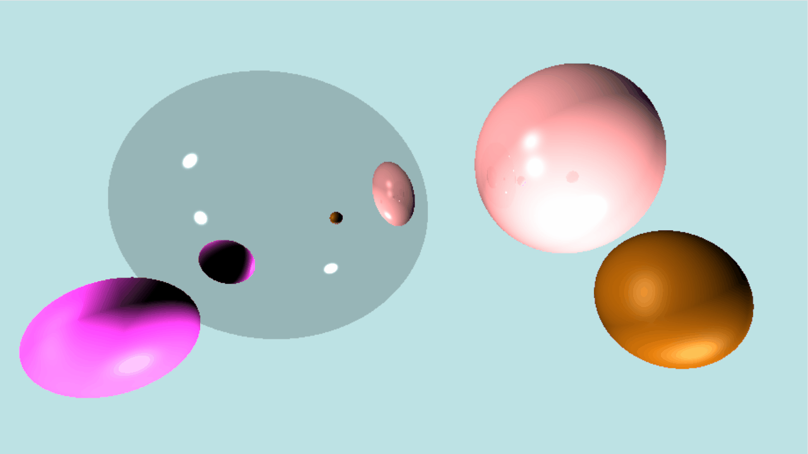
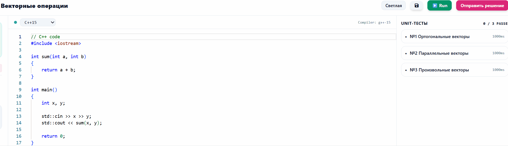
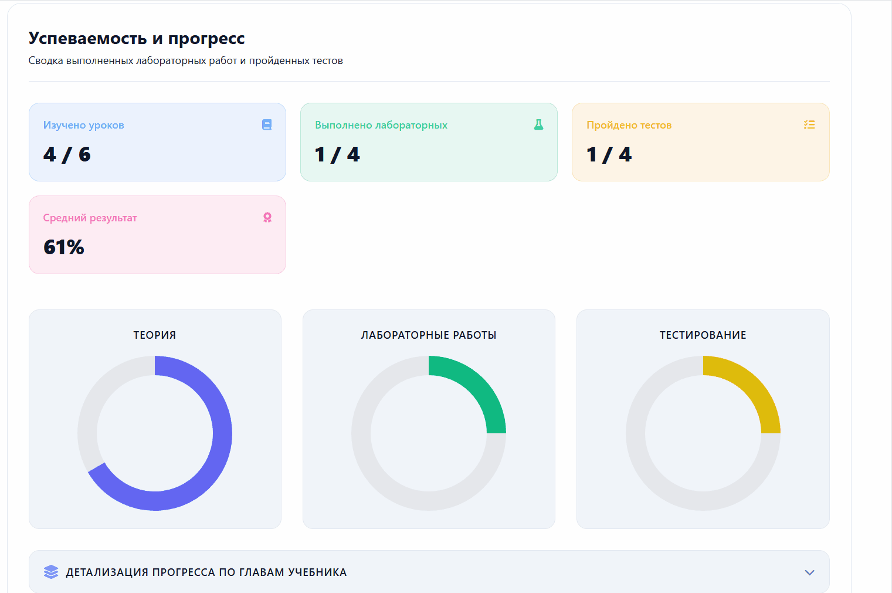

<div align="center">

# 🎓 VirtualLab Edu

**Учебно-демонстрационная платформа для изучения алгоритмов реалистичного рендеринга (Ray Tracing & Path Tracing)**

[](#)
[](#)
[](#)
[](#)
[](#)
[](#)

*Интерактивная образовательная среда, объединяющая теорию и визуальный симулятор трассировки лучей и пути в реальном времени и практикум с автоматической проверкой кода.*

<br />
    
</div>

---

## 📖 О проекте

**VirtualLab Edu** создана для наглядного изучения физически корректного синтеза изображений. Вместо разрозненных конспектов и сторонних компиляторов система объединяет весь учебный цикл в одном окне браузера:

1. **Изучение теории** — структурированный электронный учебник с отслеживанием прогресса по разделам и отдельным урокам.
2. **Виртуальная лаборатория** — интерактивный симулятор для сравнения трассировки лучей (**Ray Tracing**) и трассировки пути (**Path Tracing**).
3. **Практика программирования** — встроенная рабочая среда для написания алгоритмов с автоматической компиляцией и проверкой по unit-тестам.
4. **Контроль знаний и аналитика** — тестирование с разбором ошибок, журнал оценок и персональная статистика успеваемости.

---

## ✨ Ключевые возможности

### 👨‍🎓 Для студентов

* **🔬 Интерактивная демонстрация (Ray Tracing vs Path Tracing)**
  Визуальное сравнение алгоритмов в реальном времени: настройка источников света, материалов (диффузные, зеркальные, преломляющие поверхности), глубины рекурсии, пошаговая демонстрация каждого алгоритма.
* **📚 Теоретический блок**
  Последовательное освоение материалов по геометрической оптике, уравнению рендеринга и трассировке.
* **💻 Лабораторные работы**
  Решение практических задач прямо в браузере с поддержкой нескольких ЯП (**C++ (`g++`)**, **Python**, **C# (`.NET`)** и **Go**):
  * сохранение черновиков решений;
  * быстрая проверка на тестовых данных с выводом ошибок компиляции;
  * отправка итогового решения на проверку преподавателю с получением комментариев и оценки.
* **📝 Модуль тестирования**
  Контрольные тесты с поддержкой одиночного выбора, текстовых и числовых ответов и подробным анализом результатов прохождения.
* **📊 Личный кабинет и аналитика**
  Наглядные диаграммы прогресса по теории, лабораторным и тестам, история всех попыток, лента уведомлений и переключение темы интерфейса.

<div align="center">
  
</div>

---

### 👨‍🏫 Для преподавателей

* **🗂 Конструктор учебного контента**
  Создание и редактирование глав учебника, уроков, лабораторных работ (шаблоны кода, JSON-описание задач, набор unit-тестов) и тестирований.
* **✅ Проверка работ и сводный журнал**
  Единый журнал успеваемости по группам, ревью отправленных лабораторных работ с выставлением комментариев, просмотр статистики прохождения тестов.
* **👥 Управление доступом и группами**
  Модерация заявок новых студентов, распределение по учебным группам, управление ролями и публикация объявлений на дашборде курса.

<div align="center">
  
</div>

---

## 🛡 Безопасность и архитектура

* **Ролевая модель доступа (RBAC):** разделение клиентских и административных маршрутов API с проверкой прав на уровне middleware.
* **Двухфакторная аутентификация (2FA):** поддержка TOTP (Google Authenticator, Яндекс Ключ, Authy) с генерацией QR-кода и функцией запоминания доверенного устройства на 7 дней.
* **Защита API:** ограничение частоты запросов (Rate Limiting на вход, сброс пароля и ввод 2FA-кодов), валидация входящих данных по схемам **Zod**, защита заголовков через **Helmet**.
* **Наблюдаемость (Observability):** централизованная обработка исключений и автоматический мониторинг серверных сбоев в **Sentry** с фильтрацией конфиденциальных данных.

---

## 🛠 Технологический стек

| Слой | Технологии |
| :--- | :--- |
| **Backend** | Node.js, Express, PostgreSQL, Prisma ORM |
| **Frontend** | Vanilla JavaScript (ES6+), Tailwind CSS, Chart.js, SweetAlert2 |
| **Core** | C++, WASM |
| **Безопасность и Auth** | JWT, bcryptjs, TOTP (RFC 6238), QRCode, Helmet, express-rate-limit, Zod |
| **Мониторинг и почта** | Sentry (`@sentry/node`), Nodemailer |
| **Среда исполнения задач** | `g++-15`, `python-3.14`, `dotnet-csharp-10`, `go-1.26` |

---

## 📂 Структура проекта

```text
├── backend/
│   ├── config/                 # Конфигурация CORS, Helmet и Rate Limiter
│   ├── prisma/                 # Схема базы данных и миграции
│   ├── src/
│   │   ├── controllers/
│   │   │   ├── admin/          # Управление курсом, тестами, ЛР, учебником и проверкой работ
│   │   │   └── student/        # Прогресс, прохождение тестов, отправка ЛР, профиль
│   │   ├── routers/
│   │   │   └── admin/          # Модульная маршрутизация панели управления (/api/v1/admin/*)
│   │   ├── services/           # Компилятор, JWT, валидатор, уведомления, обработчик ошибок
│   │   ├── utils/              # AppError, catchAsync, TOTP-генератор, Sentry, почтовая рассылка
│   │   └── validators/         # Схемы валидации запросов
│   └── server.js               # Точка входа сервера
├── core/
│   ├── src/                    # Исходный код для Ray Tracing
│   └── engine.cpp              # Демонстрационный трассировщик лучей
│   └── engine.js               # Линкер для WASM
│   └── engine.wasm             # WASM модуль
└── frontend/
    ├── admin/                  # Интерфейсы управления (учебник, задачи, тесты, студенты)
    ├── authorization/          # Вход, регистрация, восстановление пароля
    ├── demo/                   # Интерактивный симулятор Ray Tracing & Path Tracing
    ├── profile/                # Дашборд успеваемости, настройки профиля и подключение 2FA
    ├── testing/                # Модуль прохождения тестов и детальный разбор результатов
    ├── theory/                 # Электронный учебник
    ├── workspace/              # Среда выполнения лабораторных работ
    └── index.html              # Главный дашборд системы
```